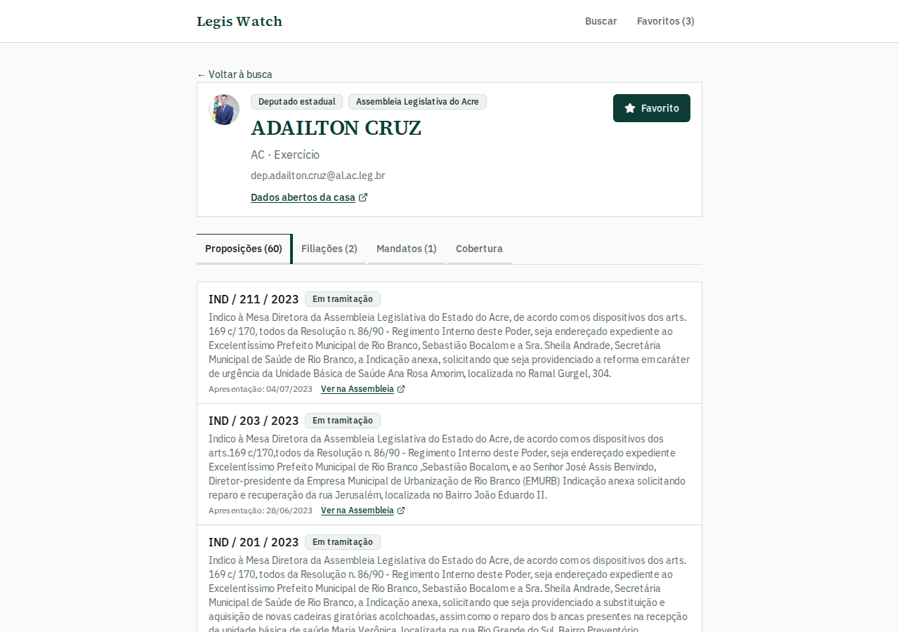
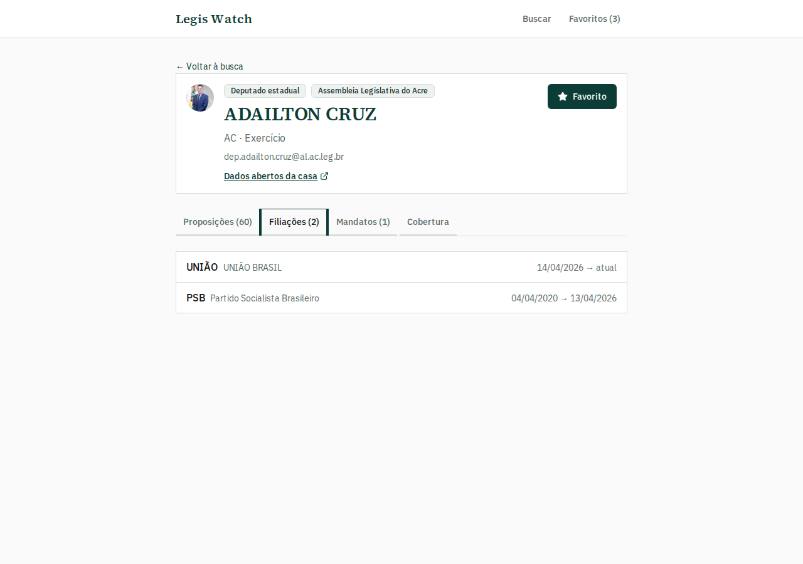
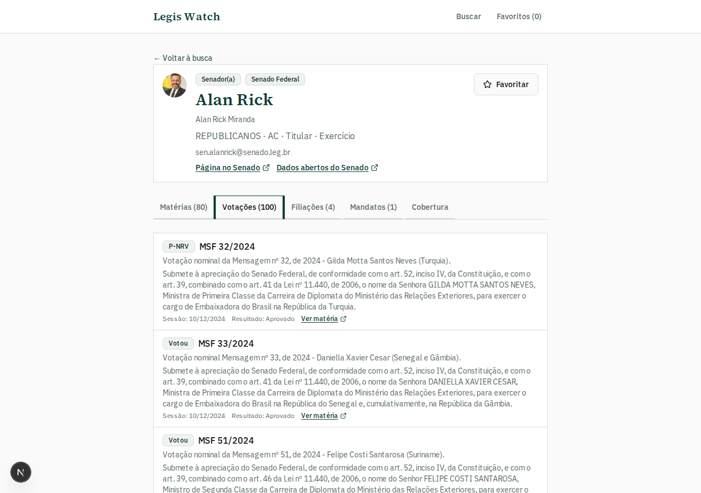

# Legis Watch — Guia do usuário

> Navegação: [Índice](./README.md) · [Estaduais por UF](./estaduais.md) · [Senadores](./senado.md) · [API interna](./backend-api.md) · [README](../README.md)

Guia das **telas e funcionalidades** do produto, com prints atualizados do app em `localhost:3456`.

**Legis Watch** acompanha parlamentares brasileiros com dados públicos:

| Esfera | Casa | O que você vê no perfil |
|---|---|---|
| **Deputados federais** | Câmara dos Deputados | Projetos, votações, presença/ata, partido |
| **Deputados estaduais** | 27 Assembleias / CLDF | Cadastro em todas; proposições, filiações e mandatos nas casas com API |
| **Senadores** | Senado Federal | Matérias, votações nominais, filiações, mandatos + disclaimer de presença |

Repositório: [github.com/Frois19/legis-watch](https://github.com/Frois19/legis-watch)  
Para regenerar os prints: `npm run docs:screenshots` (dev server em `:3456`).

---

## O que há de novo

| Novidade | Onde usar |
|---|---|
| Perfil do **senador** com matérias, **votações nominais**, filiações e mandatos | Busca → Senadores → abrir perfil |
| **Favoritos** multi-esfera (federal, estadual e senador) | Estrela na lista/perfil · página Favoritos |
| Perfil **estadual enriquecido** (SAPL: AC, AL, AM, PB, PI, RO, TO) | Busca → Estaduais → UF → perfil |
| Perfil **MG (ALMG)** com filiações e mandatos | Busca → Estaduais → UF MG → perfil |
| Cobertura clara do que cada casa já publica | Aba **Cobertura** no perfil estadual ou do Senado |

---

## Mapa de funcionalidades

| Funcionalidade | Esfera | O que resolve |
|---|---|---|
| Busca por esfera | Todas | Filtrar federais, estaduais, senadores ou todos |
| Busca por mandato | Federal | Legislatura (ex.: 56ª / 57ª) |
| Busca por UF / partido / nome | Estadual e Senado | Achar o parlamentar rápido |
| Favoritos locais | Todas | Guardar no navegador, sem login |
| Projetos / proposições | Federal + SAPL estadual + Senado | O que a pessoa apresentou |
| Votações nominais | Federal + Senado | Sim / Não / Abstenção + matéria relacionada |
| Presença e ata do dia | Federal | Faltas + pauta e votações da sessão |
| Filiações e mandatos | Senado + SAPL + MG | Histórico partidário e legislaturas |
| Disclaimer de presença | Senado | A API não equivale à da Câmara — link ao tutorial oficial |

---

## 1. Busca (federal, estadual e senadores)

Na home, escolha a **esfera** e os filtros. No federal, escolha também o **mandato**.

**Na prática**

- Esfera: Deputados federais · Deputados estaduais · Senadores · Todos
- Federais: legislaturas recentes (52ª–57ª)
- Estaduais: 27 UFs (9 casas live — PE, MG e 7 SAPL; demais com cadastro de demonstração)
- Senadores: lista em exercício do Senado
- Resultados com foto (quando houver), partido, UF e nome da casa

### Resultados federais

Exemplo: “Janones” na 56ª legislatura.

### Resultados estaduais

Exemplo: esfera estadual + UF **PE**.

### Resultados de senadores

Exemplo: esfera **Senadores** + UF **AC**.

---

## 2. Perfil federal — projetos

Resumo do mandato, contadores e abas. Em **Projetos**:

- Filtro por **status**
- Título como link para a ficha na Câmara
- Ementa, data e status

---

## 3. Votações (Sim / Não / Abstenção)

Aba **Votações** (federal):

- Cards: Sim, Não, Abstenção e Outros
- Filtro por tipo de voto
- Em cada item: voto, resultado da sessão, ementa e link do projeto

Útil para: *“em quais matérias ele votou não?”*

---

## 4. Presença, faltas e ata do dia

Aba **Presença** (federal):

- Filtros: todas · só faltas · só presenças
- **Ver ata do dia**: pauta, votações nominais, links do evento/vídeo

---

## 5. Partido (federal)

Lista outros deputados do mesmo partido no mandato selecionado.

---

## 6. Favoritos

Parlamentares **federais, estaduais e senadores** salvos neste dispositivo (`localStorage`). A lista mostra a esfera (Federal · Estadual · Senado) junto do partido e da UF.

---

## 7. Perfil estadual

URL: `/parlamentares/{source}/{id}`

### Cadastro em todas as UFs

Nome, partido, UF, e-mail (quando houver), badge da casa e tabela de cobertura.

### Casas com perfil enriquecido

Ao abrir o perfil, o app sincroniza sob demanda o que a Assembleia publica:

| Casa | `source` | Proposições | Filiações | Mandatos |
|---|---|---|---|---|
| Acre, Alagoas, Amazonas, Paraíba, Piauí, Rondônia, Tocantins | `aleac`, `aleal`, `aleam`, `alepb`, `alepi`, `alero`, `aleto` | Sim (SAPL) | Sim | Sim |
| Minas Gerais | `almg` | Não (API bloqueada) | Sim | Sim |
| Pernambuco | `alepe` | Não | — | — |
| Demais UFs | fixture | — | — | — |

#### Minas Gerais (ALMG) — filiações e mandatos

#### Acre (SAPL) — proposições de autoria

Catálogo completo: [estaduais.md](./estaduais.md).

---

## 8. Senadores

Esfera **Senadores** · perfil `/parlamentares/senado/{codigo}`.

Ao abrir, o app enriquece com Dados Abertos do Senado:

| Aba | Conteúdo |
|---|---|
| **Matérias** | Autorias (ementa, data, link no Senado) |
| **Votações** | Voto nominal + matéria e resultado da sessão |
| **Filiações** | Histórico partidário |
| **Mandatos** | UF, participação e legislaturas |
| **Cobertura** | O que já está disponível + disclaimer de presença |

Presença no Senado **não** é inferida pela API — use o tutorial oficial de assiduidade (link na aba Cobertura). Detalhes: [senado.md](./senado.md).

---

## Fluxo típico

1. Abrir a busca e escolher a esfera  
2. Federal: escolher o mandato · Estadual/Senado: filtrar por UF se quiser  
3. Abrir o perfil  
4. **Federal:** Projetos → Votações → Presença (ata) → Partido  
5. **Estadual (SAPL/MG):** Proposições / Filiações / Mandatos / Cobertura  
6. **Senador:** Matérias / Votações / Filiações / Mandatos / Cobertura  

---

## Dados e limitações

- **Federal:** Dados Abertos da Câmara (API + arquivos anuais)
- **Estadual:** 9 casas live (PE, MG, 7 SAPL); 18 UFs em fixture de cadastro — [estaduais.md](./estaduais.md)
- **Senado:** lista + perfil enriquecido (matérias e votos); presença só pelo Diário / tutorial oficial
- Favoritos: federal, estadual e senador; só neste navegador
- Votos/presença estaduais: ainda não (APIs sem voto nominal por parlamentar de forma utilizável)

Setup e sync: [README](../README.md).

---

## Continuar navegando

- [Índice da documentação](./README.md)
- [Deputados estaduais por UF](./estaduais.md)
- [Senadores](./senado.md)
- [APIs da Câmara](./apis-v1.md)
- [API interna](./backend-api.md)
