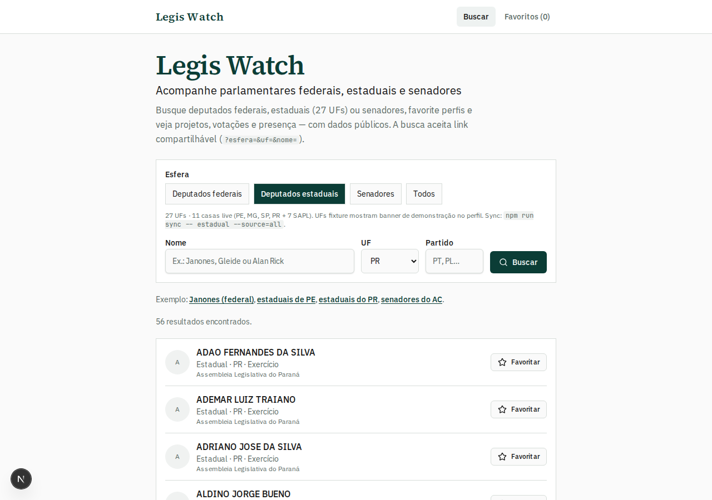
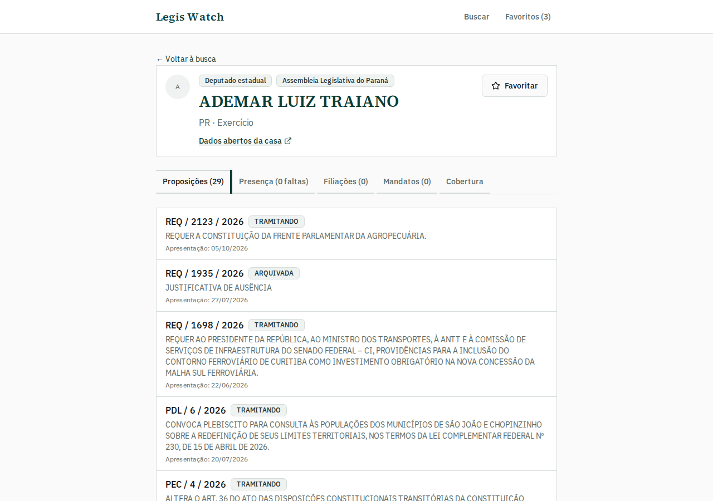
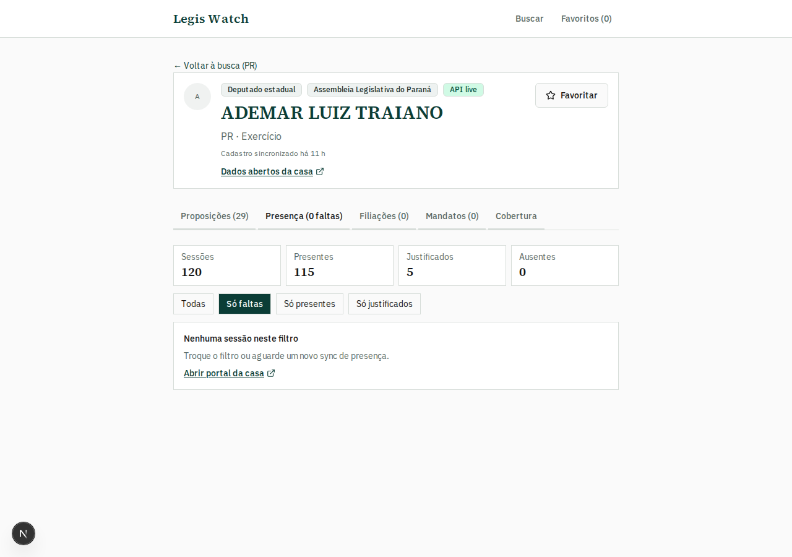
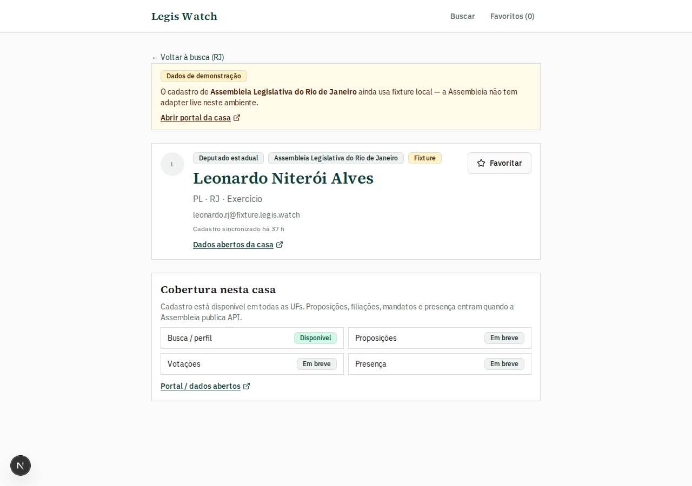

# Legis Watch — Guia do usuário

> Navegação: [Índice](./README.md) · [Estaduais](./estaduais.md) · [Senadores](./senado.md) · [Roadmap](./PLANO-EXPANSAO.md) · [README](../README.md)

Telas e funcionalidades do produto, com prints do app em `localhost:3456`.

**Legis Watch** acompanha parlamentares brasileiros com dados públicos:

| Esfera | Casa | No perfil |
|---|---|---|
| **Deputados federais** | Câmara dos Deputados | Projetos, votações, presença/ata, partido |
| **Deputados estaduais** | 27 Assembleias / CLDF | Cadastro em todas; proposições / filiações / mandatos / presença conforme a casa |
| **Senadores** | Senado Federal | Matérias, votações, filiações, mandatos + disclaimer de presença |

Repo: [github.com/Frois19/legis-watch](https://github.com/Frois19/legis-watch)  
Regenerar prints: `npm run docs:screenshots` (dev server em `:3456`).

---

## Mapa de funcionalidades

| Funcionalidade | Esfera | O que resolve |
|---|---|---|
| Busca por esfera | Todas | Federais, estaduais, senadores ou todos |
| Busca por mandato | Federal | Legislatura (ex.: 56ª / 57ª) |
| Busca por UF / partido / nome | Estadual e Senado | Achar o parlamentar rápido |
| Favoritos locais | Todas | Guardar no navegador, sem login |
| Projetos / proposições | Federal + casas live + Senado | O que a pessoa apresentou |
| Votações nominais | Federal + Senado | Sim / Não / Abstenção + matéria |
| Presença e ata | Federal | Faltas + pauta e votações do dia |
| Presença plenária | **Paraná (ALEP)** | Sessões com presente / justificado / ausente |
| Filiações e mandatos | Senado + SAPL + MG | Histórico partidário e legislaturas |
| Cobertura da casa | Estadual + Senado | O que já está disponível vs em breve |

---

## 1. Busca

Na home, escolha a **esfera** e os filtros. No federal, escolha também o **mandato**.

A URL reflete a busca e pode ser compartilhada, por exemplo  
`/?esfera=estadual_deputado&uf=PR` ou `/?esfera=senador&uf=AC`.

**Na prática**

- Esfera: Deputados federais · Deputados estaduais · Senadores · Todos
- Federais: legislaturas recentes (52ª–57ª)
- Estaduais: **11 casas live** (PE, MG, SP, PR + 7 SAPL) e 16 UFs com cadastro de demonstração (banner no perfil)
- Senadores: lista em exercício do Senado
- Perfis mostram **frescor** (“atualizado há X h”) e skeleton enquanto enriquecem

### Resultados federais

Exemplo: “Janones” na 56ª legislatura.

### Resultados estaduais

Pernambuco (ALEPE):

Paraná (ALEP — live com proposições e presença):

### Resultados de senadores

Exemplo: esfera **Senadores** + UF **AC**.

---

## 2. Perfil federal — projetos

Resumo do mandato, contadores e abas. Em **Projetos**: filtro por status, link para a Câmara, ementa e data.

---

## 3. Votações (Sim / Não / Abstenção)

Aba **Votações** (federal): cards por tipo de voto, filtro e matéria relacionada.

---

## 4. Presença, faltas e ata do dia

Aba **Presença** (federal): filtros (todas / faltas / presentes) e **Ver ata do dia** (pauta + votações).

---

## 5. Partido (federal)

Outros deputados do mesmo partido no mandato selecionado.

---

## 6. Favoritos

Parlamentares **federais, estaduais e senadores** neste dispositivo (`localStorage`).

---

## 7. Perfil estadual

URL: `/parlamentares/{source}/{id}`

### Exemplos por casa

UFs ainda em fixture mostram banner de demonstração:

### O que cada casa live entrega

| Casa | `source` | Proposições | Filiações | Mandatos | Presença |
|---|---|---|---|---|---|
| AC, AL, AM, PB, PI, RO, TO | `aleac`… | SAPL | Sim | Sim | — |
| Minas Gerais | `almg` | CSV anual | Sim | Sim | — |
| São Paulo | `alesp` | XML/ZIP | — | — | — |
| Pernambuco | `alepe` | XML (+ fixture se offline) | — | — | — |
| Paraná | `alep` | Webservice | — | — | **Plenário** |
| Demais UFs | fixture | — | — | — | — |

Catálogo completo: [estaduais.md](./estaduais.md).

---

## 8. Senadores

Esfera **Senadores** · `/parlamentares/senado/{codigo}`.

| Aba | Conteúdo |
|---|---|
| **Matérias** | Autorias (ementa, data, link) |
| **Votações** | Voto nominal + matéria e resultado |
| **Filiações** | Histórico partidário |
| **Mandatos** | UF, participação e legislaturas |
| **Cobertura** | O que existe + disclaimer de presença |

Presença no Senado **não** é inferida pela API — use o tutorial oficial (link na aba Cobertura). Detalhes: [senado.md](./senado.md).

---

## Fluxo típico

1. Busca → escolher esfera (e UF / mandato)  
2. Abrir o perfil  
3. **Federal:** Projetos → Votações → Presença (ata) → Partido  
4. **Estadual:** Proposições / Presença (PR) / Filiações / Mandatos / Cobertura  
5. **Senador:** Matérias / Votações / Filiações / Mandatos / Cobertura  
6. Favoritar se quiser acompanhar depois  

---

## Dados e limitações

- **Federal:** Dados Abertos da Câmara  
- **Estadual:** 11 live · 16 fixture — [estaduais.md](./estaduais.md) · [fontes](./fontes-endpoints.md)  
- **Senado:** matérias e votos; presença só pelo Diário / tutorial  
- Favoritos: só neste navegador  
- Votos nominais estaduais: ainda não indexados (ZIP ALEP documentado no roadmap)  

Roadmap (qualidade + features): [PLANO-EXPANSAO.md](./PLANO-EXPANSAO.md).

---

## Continuar

- [Índice](./README.md) · [Estaduais](./estaduais.md) · [Senadores](./senado.md) · [API interna](./backend-api.md)
